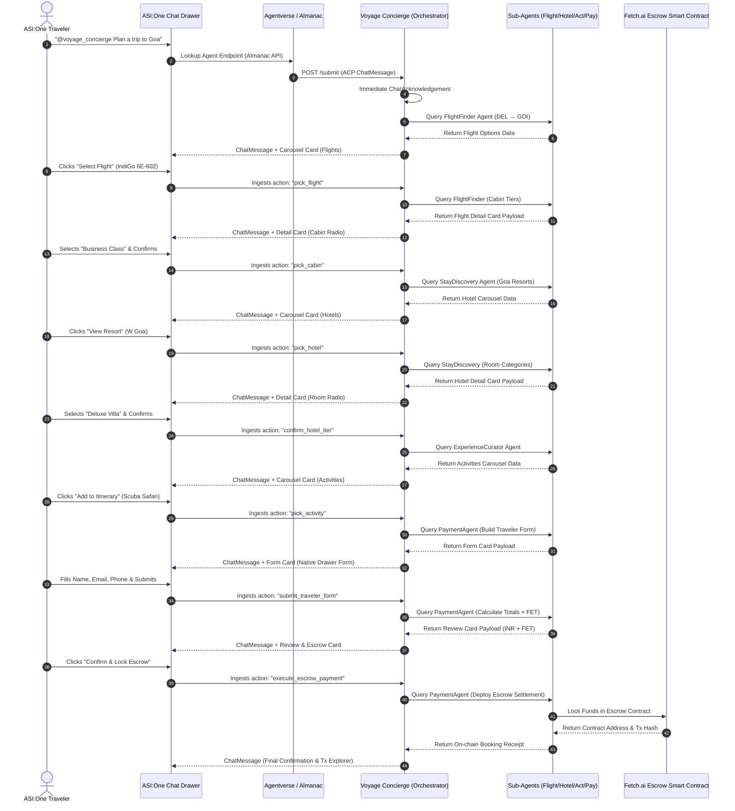

# 🛠️ VoyageAI — Product Workflow Document (PWD)
### System Architecture, State Machine & Execution Workflow
**Challenge:** ASI:One Agent Challenge (Fetch-A-Thon 3.0)  
**Protocol:** Agent Chat Protocol (ACP) v1.0 & ASI:One Interactive Cards  
**Network:** Fetch.ai Dorado Testnet  

---

## 1. End-to-End System Architecture



---

## 2. Conversational State Machine

The Voyage Concierge tracks user state per sender address (`ctx.storage.get(sender)`) across 8 deterministic stages:

```
[Start / Idle]
      │
      ▼ (User prompt: "plan a trip to goa")
[Stage: flights] ─────────────► Renders Flights Carousel
      │
      ▼ (Action: "pick_flight")
[Stage: flight_detail] ───────► Renders Flight Detail Card (Cabin Radio)
      │
      ▼ (Action: "pick_cabin")
[Stage: hotels] ──────────────► Renders Hotels Carousel
      │
      ▼ (Action: "pick_hotel")
[Stage: hotel_detail] ────────► Renders Hotel Detail Card (Room Tier Radio)
      │
      ▼ (Action: "confirm_hotel_tier")
[Stage: activities] ──────────► Renders Activities Carousel
      │
      ▼ (Action: "pick_activity")
[Stage: traveler_form] ───────► Renders Native Traveler Intake Form
      │
      ▼ (Action: "submit_traveler_form")
[Stage: review] ──────────────► Renders Itinerary Review & Escrow Breakdown
      │
      ▼ (Action: "execute_escrow_payment")
[Stage: confirmed / terminal] ─► Smart Escrow Locked on Ledger & Tx Hash Emitted
```

---

## 3. Wire Protocol & Card Payload Schemas

### 3.1 ACP Metadata Content Container
Every interactive response from the agent contains both plain conversational prose and machine-readable metadata conforming to the **ASI:One Card Protocol**:

```json
{
  "card_protocol_version": "1",
  "requires_card_interaction": "true",
  "card_kind": "carousel",
  "card_payload": "{...stringified JSON payload...}",
  "preferred_drawer_width_px": "580"
}
```

### 3.2 Implemented Card Kinds

#### A. Carousel Card (`card_kind: "carousel"`)
Used for browsing flights, resorts, and local adventures:
```json
{
  "title": "Select Outbound Flight",
  "subtitle": "DEL ✈️ GOI · Direct Options",
  "items": [
    {
      "id": "fl_indigo_602",
      "image": "https://images.unsplash.com/photo-1436491865332-7a61a109cc05?w=128",
      "title": "IndiGo 6E-602",
      "subtitle": "06:15 AM - 08:50 AM · 2h 35m",
      "badges": [{"label": "Fastest", "variant": "info"}],
      "secondary_text": "₹5,400",
      "primary_cta": {
        "label": "Select Flight",
        "selection": {
          "action": "pick_flight",
          "flight_id": "fl_indigo_602",
          "airline": "IndiGo 6E-602"
        }
      }
    }
  ]
}
```

#### B. Detail Card with Sub-Options (`card_kind: "detail"`)
Used for cabin selection and room tier picking:
```json
{
  "title": "IndiGo 6E-602 · Flight Details",
  "hero_image": "https://images.unsplash.com/photo-1436491865332-7a61a109cc05",
  "summary_rows": [
    {"label": "Route", "value": "DEL → GOI"},
    {"label": "Departure", "value": "06:15 AM"},
    {"label": "CO₂ Offset", "value": "112 kg"}
  ],
  "sub_options": {
    "name": "cabin_class",
    "kind": "radio",
    "label": "Select Cabin Class",
    "choices": [
      {"value": "economy", "label": "Economy Class", "secondary_text": "₹5,400 (Standard 15kg)"},
      {"value": "business", "label": "Business Class", "secondary_text": "₹11,500 (Priority + Lounge)"}
    ]
  },
  "ctas": [
    {
      "label": "Confirm Cabin & Proceed",
      "primary": true,
      "selection": {"action": "pick_cabin", "flight_id": "fl_indigo_602"}
    }
  ]
}
```

#### C. Native Drawer Form Card (`card_kind: "form"`)
Used for lead passenger contact collection:
```json
{
  "title": "Traveler & Contact Information",
  "subtitle": "Reserving for IndiGo 6E-602 + W Goa",
  "fields": [
    {"name": "full_name", "label": "Lead Passenger Full Name", "type": "text", "required": true},
    {"name": "email", "label": "Email Address", "type": "email", "required": true},
    {"name": "phone", "label": "Phone Number", "type": "tel", "required": true},
    {"name": "special_requests", "label": "Special Requests", "type": "text", "required": false}
  ],
  "submit_cta": {
    "label": "Generate Final Itinerary & Review",
    "selection": {"action": "submit_traveler_form"}
  }
}
```

#### D. Review & Escrow Card (`card_kind: "review"`)
Used for final price lock and smart escrow authorization:
```json
{
  "title": "Itinerary Review & Escrow Authorization",
  "subtitle": "Trip #VYG-882A1B · Lead Traveler: Rahul Sharma",
  "items": [
    {"label": "Flight: IndiGo 6E-602 (Business)", "amount": "₹11,500"},
    {"label": "Stay: W Goa (2 Nights, Deluxe Villa)", "amount": "₹49,000"},
    {"label": "Experience: Grand Island Scuba Diving", "amount": "₹3,200"},
    {"label": "Taxes, Insurance & Surcharges (12% GST)", "amount": "₹7,644"}
  ],
  "total": {
    "label": "Total Amount (Protected by Escrow)",
    "amount": "₹71,344",
    "secondary_amount": "839.34 FET"
  },
  "ctas": [
    {
      "label": "Confirm & Lock Escrow (839.34 FET)",
      "primary": true,
      "selection": {"action": "execute_escrow_payment"}
    }
  ]
}
```

---

## 4. Robust Ingestion & Parsing Architecture

ASI:One delivers user interactions in two distinct formats:
1. **Verbatim JSON** when users click card action buttons. In ASI:One, these are prefixed with `@agent1q...` (e.g., `@agent1qw0wxtlush... {"action": "pick_flight", "flight_id": "fl_indigo_602", "approved": true}`).
2. **Natural Language Prose** when users reply with freeform text or speak into the voice prompt.

### The Robust Ingestion Pipeline:
```python
def parse_incoming_selection(text: str) -> Dict[str, Any]:
    cleaned = text.strip()

    # 1. Strip leading @mention if present
    cleaned_no_mention = re.sub(r"^@agent1[a-z0-9]+\s*", "", cleaned).strip()

    # 2. Extract JSON dictionary block {...} via regex
    json_match = re.search(r"\{.*\}", cleaned, re.DOTALL)
    candidates = []
    if json_match:
        candidates.append(json_match.group(0))
    candidates.extend([cleaned_no_mention, cleaned])

    for c in candidates:
        try:
            data = json.loads(c)
            if isinstance(data, dict):
                return data
        except Exception:
            pass

    # 3. Heuristic fallback for planner natural language prose
    ...
```

---

## 5. Fetch.ai Smart Escrow Protocol Execution

Upon receiving `execute_escrow_payment`:
1. **Total Fee Computation**:
   $$\text{Subtotal} = P_{\text{flight}} + (P_{\text{hotel}} \times \text{nights}) + P_{\text{activity}}$$
   $$\text{GST} = \text{round}(\text{Subtotal} \times 0.12)$$
   $$\text{Total INR} = \text{Subtotal} + \text{GST}$$
   $$\text{Total FET} = \text{round}\left(\frac{\text{Total INR}}{85.0}, 2\right)$$
2. **Protocol Fee Split**:
   $$\text{Orchestrator Commission (1.5%)} = \text{round}(\text{Total FET} \times 0.015, 2)$$
   $$\text{Vendor Escrow Pool} = \text{Total FET} - \text{Protocol Fee}$$
3. **Smart Contract Allocation**:
   - Contract Address: `fetch1escrow<hex>`
   - Transaction Hash: `0x<hex>`
   - Milestone 1: 50% released on airport boarding check-in.
   - Milestone 2: 50% released on resort reception check-in.
4. **Session Cleanup**:
   - The user session is flushed from `ctx.storage` so subsequent queries begin fresh.

---

## 6. Execution Modes (Local vs. Hosted)

| Mode | Entrypoint | Tunnel Needed? | Best Used For |
| :--- | :--- | :--- | :--- |
| **Local Tunnel Mode** | `python voyage_orchestrator.py` | Yes (`npx localtunnel --port 8000`) | Rapid local prototyping, debugging mock data, live code iteration |
| **Hosted Cloud Mode** | `agentverse_hosted_agent.py` | No (Cloud 24/7) | Hackathon demo, zero maintenance, permanent uptime |
